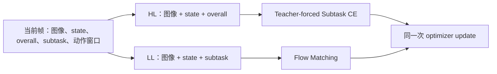

# 实现与数据契约

用本记录定位实验 C 的代码改动，并恢复训练与推理对数据的共同要求。先确认 annotation 的含义，再看两条训练数据流和参数更新范围，最后核对部署接口。

## 从原有 Prompt 到显式规划

原有 LoRA baseline 的训练文本包含 overall instruction 和当前 subtask，推理却只提供 overall。实验 C 增加一个可监督、可观察的中间输出：当前 observation + overall → subtask；低层再接收当前 observation + subtask → action chunk。

这遵循 π0.5 显式高低层分解的方向，但本轮是小规模 downstream LoRA 实验。下文的文本模板、交替比例、loss 权重和 token 限额是当前工程实现的选择，不应标成原论文全部训练细节的精确复现。联合 CE 是否提高 box folding 动作能力需要实验回答；训练 CE 下降本身不能回答这个问题。

## 数据调整留下的契约

转换输入为 `/home/deng/Documents/dataset/20260805_FoldBox_SpiritAI_Moz1WB_10Annotations/`，最终输出为同级的 `20260805_FoldBox_SpiritAI_Moz1WB_10subtasks/`。初版转换布局偏离 LeRobot v2.1，按用户要求删除重做；最终转换使用临时目录 staging，再交付最终数据目录。转换工具没有放入训练代码。

| 位置 | 最终含义 |
|---|---|
| `meta/tasks.jsonl` | task 0 保存整项折盒任务的 overall instruction |
| parquet 的 `task_index` | 指向 overall task；当前数据为 0 |
| parquet 的 `subtask` | 当前帧对应的非空自然语言 subtask；不是任务编号或模型隐状态 |
| `meta/info.json.features.subtask` | `dtype: string`、`shape: [1]`、`names: null` |
| `meta/episodes.jsonl` | episode 的 `tasks` 与 overall 对齐 |
| `data/chunk-*/episode_*.parquet`、`videos/chunk-*/*/*.mp4` | 保留 LeRobot v2.1 的数据与视频组织方式 |

最终数据为 712 episodes、1148747 frames、30 FPS、1 个 overall task。历史转换报告记录 12 种 subtask 文本，含 recovery 标签；目录名中的 `10` 不能用来推断实际 distinct label 数。转换没有重新定义 subtask 语义或修改 annotation 时间边界。

源 `annotations.json`、`dataset.json`、`meta/tasks_original.jsonl` 和 `meta/episodes_stats.jsonl` 按当时要求原样保留。训练以 active LeRobot metadata、parquet 和视频为准；`dataset.json` 是旧导出，不能与 active metadata 混用。原 metadata 的 `total_videos=2136` 与实际 4272 个 mp4 的既有差异也被保留，本轮转换没有修复这一源数据问题。[转换报告](artifacts/data_conversion_report.json)

官方 `LeRobotDataset` reader 曾使用 torchcodec 读取 episodes 0、198、711 并抽样解码图像。[抽样记录](artifacts/data_reader_smoke_test.json)证明该 reader 路径可用，不等于对每个视频做了完整解码审计。2026-11-04 补档又只读核对了最终目录的 metadata、712 个 parquet 文件和首帧文本；两种核对的范围均记录在[备份清单](artifacts/engineering_backup_manifest.json)。

以后重新转换时，先在 staging 中保留原有 episode/frame 索引和媒体布局，只改变有定义的文本字段；用官方 reader 读取跨 episode、跨 subtask 的样本后再替换输出。完整数据和视频仍需单独备份，仓库中的报告不能恢复它们。

## 一条记录如何进入两个训练目标

loader 从 LeRobot task 解析 overall，保留逐帧 subtask，再在线构造两种视图。两种视图都使用当前图像和机器人 state；只有文本条件与监督目标不同。

HL 文本前缀为 `Task: {overall}, State: ...;\nSubtask: `，state 存在时按现有规范离散化；response 是 subtask 文本及 EOS。prefix 可双向注意，response 使用 causal mask；loss 仅作用于 shift 后的 response/EOS。先对每条记录的有效 target token 求平均，再对记录求平均。训练使用 teacher forcing，一次 VLM forward 处理 response 各位置；逐 token 生成发生在推理时。

LL 沿用原有 flow-matching 动作训练，条件文本替换为当前 subtask。三路图像进入模型后为 224×224；Cartesian state/action 为 25D，模型 action pad 到 32D，horizon 为 50。`discrete_state_input=true`、`max_token_len=256`、`max_subtask_tokens=96`；HL 序列超长会报错，不能静默截掉 target。

当前 sampler 沿用原有动作窗口规则。窗口可能跨 subtask 边界，整个窗口仍由起始帧标签条件化；这是一项明确的工程近似，尚未做边界采样消融。

## Loss、批次与梯度

每个 rank 的 microbatch 按 `subtask → flow → subtask → flow` 交替，两张卡保持相同分支顺序。global 64、micro 8、2 ranks 对应每 rank 4 轮梯度累积：一次更新包含 32 条 HL 记录和 32 个 LL 动作窗口。相邻分支消费不同记录，当前实现没有对每条记录同时计算两种 loss。

逻辑目标为 `L = 1 × mean(CE_HL) + 10 × mean(FM_LL)`。单个 microbatch 的模型返回值分别乘 `2 × text_loss_weight` 或 `2 × flow_loss_weight`，用于抵消 worker 按全部累积轮数平均带来的二分之一系数。以后修改混合比例时必须一并重推这个归一化，不能只改变交替次序。

LoRA 作用于两个 Gemma expert 的 attention q/k/v/o 和 FFN。VLM rank/alpha 为 16/16，Action Expert 为 32/32；共 33472512 个可训练参数、432 个 adapter tensor。基础参数、vision、token embedding/输出共享权重、norm、action/time projection 冻结；LoRA A 为现有 Gaussian 初始化，B 为零。FM 梯度仍可通过动作专家的注意力流入 VLM adapter，本轮没有加入 KI 的梯度隔离。

冻结参数减少 optimizer 状态和权重梯度计算，但基础权重仍参与前向、activation 梯度传播以及 FSDP 参数收集。不能从 adapter 数量直接推断训练加速比例，详见[性能记录](training-and-validation.md)。

## 代码定位

按从数据到更新、再到推理的顺序查找以下入口，可以避免另建一套训练链路。

| 文件 / 符号 | 本轮职责 |
|---|---|
| [`official_sft_data_loader.py`](../../../rlinf/data/datasets/openpi/official_sft_data_loader.py) | 两种视图、分支交替、normalization 校验、数据指纹及 objective offset 恢复 |
| [`hierarchical.py`](../../../rlinf/models/embodiment/openpi/hierarchical.py) | `HierarchicalInputs`、`SubtaskTokenizer`、HL mask、规划状态 |
| [`pi0.py`](../../../rlinf/models/embodiment/openpi/pi0.py) | `compute_subtask_loss`、`sample_subtask_tokens`、联合 SFT 分支，沿用 `compute_loss` 的 FM |
| [`modules/gemma.py`](../../../rlinf/models/embodiment/openpi/modules/gemma.py) | embedding/输出投影内部的分块 CE；FSDP 调用边界修复所在 |
| [`lora.py`](../../../rlinf/models/embodiment/openpi/lora.py) / [`modules/lora.py`](../../../rlinf/models/embodiment/openpi/modules/lora.py) | 原生双 expert adapter 注入与合并 |
| [`fsdp_vla_sft_worker.py`](../../../rlinf/workers/sft/fsdp_vla_sft_worker.py) | 复用 SFT 更新，记录目标曝光量、显存、训练 metadata、loader/RNG 状态 |
| [`tasks/eval.py`](../../../rlinf/models/embodiment/openpi/tasks/eval.py) | HL 自回归生成后重建 LL 输入，隔离两套 KV cache |
| [`rtc_huggingface_worker.py`](../../../rlinf/workers/rollout/hf/rtc_huggingface_worker.py) | 维护低频规划状态、episode reset 与 subtask 切换后的 RTC guidance |
| [`merge_lora.py`](../../../rlinf/utils/ckpt_convertor/openpi/merge_lora.py) | 从训练 checkpoint 合并导出部署权重、stats 与 metadata |
| [`test_data.py`](../../../tests/unit_tests/test_data.py)、[`test_models.py`](../../../tests/unit_tests/test_models.py)、[`test_fsdp.py`](../../../tests/unit_tests/test_fsdp.py) | 数据、mask/loss、LoRA、推理契约与不等长分布式回归 |

## 部署时必须保持的条件

推理先以 overall 生成 subtask，然后用当前 observation 和生成文本重建 LL 输入。HL 使用 greedy causal decoding；它的 KV cache 不能直接作为 LL action cache。`subtask_eos` 和 `planning_seconds` 作为诊断信息记录；非空输出不等于语义正确，达到 token 上限也不能视作自然结束。

持有 `SubtaskPlanningState` 的调用方负责 episode reset，即使下一 episode 的 overall 完全相同也必须清空。RTC worker 在 bootstrap 时清空缓存；评估 YAML 默认 `planning_interval=3`，指每三个 action request 刷新，不能直接解释为 3 秒或 3 个机器人控制 tick。直接 policy 调用若不传持久状态，每次都会重新规划。subtask 改变后清除上一 action chunk 的 RTC guidance；空 subtask 会阻止动作生成。

部署使用合并后的权重并设置 `is_lora=false`，同时保留 `openpi_training.json`、训练用 stats、state 规范和 token budget。训练状态恢复与部署导出是不同操作，具体命令见[训练记录](training-and-validation.md)。这些接口保障不替代 learned planner 的文本检查和真机成功率评估。
