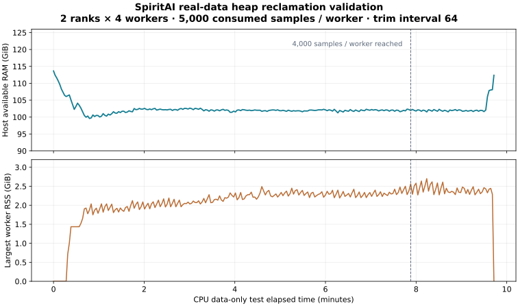

# SpiritAI 数据子进程空闲堆页回收修复

本次在已有 OpenPI dataset wrapper 中增加可配置的空闲堆页回收，处理[正式训练第 506 步退出](2026-10-28-loader-memory-failure.md)时的数据子进程 RAM 增长。修复依据是相同真实数据上的 CPU 对照：普通与 stateful loader 都增长，单独 GC 无效，单独 `malloc_trim(0)` 可以压住大部分增长。具体依赖的分配热点尚未定位，本次处理的是已证实的原生堆空闲页保留。

## 实现范围与配置

运行时修改仅在 `rlinf/data/datasets/openpi/official_sft_data_loader.py` 的已有 `_OpenPIWorkerDataset` 和 builder 中。框架默认关闭；SpiritAI recipe 启用：

```yaml
data:
  num_workers: 4
  stateful_loader: true
  worker_malloc_trim_interval: 64
```

间隔为每个 DataLoader 子进程读取的样本数。每 64 次读取，子进程调用 glibc 的 `malloc_trim`，尝试归还已经空闲的堆页。返回给训练的对象保持原样；归一化、tokenizer、样本顺序、随机数和模型 loss 均沿用原实现。函数作用见 [Linux man-pages](https://man7.org/linux/man-pages/man3/malloc_trim.3.html)。

设为 0 时关闭，负数、非整数与布尔值被拒绝。开启要求 stateful OpenPI loader；仅在真实数据子进程调用，`num_workers=0` 时不回收 actor 的主进程堆。分配器必须提供 glibc 的函数，不支持时会在回收点报错。

回收计数器不写入 checkpoint，也不加入恢复签名，因为它不改变数据与随机状态。单测覆盖了开启回收后保存、关闭回收后恢复，并逐元素比较后续观测和动作。恢复时仍需保持 worker 数、micro batch、rank 布局、seed、数据、变换和 stats 一致。

## 持续读取验证口径

验证直接调用修改后的生产 builder，使用原正式运行的真实数据、stats、seed、两 rank 和每 rank 4 个 worker。每 rank 目标为 2500 个 micro batch，每个 batch 8 个样本，即每个 worker 至少消费 5000 个样本；两 rank 共 40000 个样本，相当于 global batch 64 的 625 次更新读取量。原失败运行约为每 worker 4048 个样本。

该测试只读取数据，不加载模型或执行优化器更新；每约 2 秒采样主机 RAM 和所有子进程 RSS/USS。设置 15 分钟时间上限、主机可用 RAM 低于 20 GiB 或诊断进程合计 RSS 超过 70 GiB 时中止。结果需要与后续有限双卡训练、保存和新进程恢复分别评估，不能把读取量等价称为完成了 625 步训练。

实测约 585 秒完成，两 rank 均正常退出，每 worker 完整消费 5000 个样本。253 个采样点中，最低主机可用 RAM 为 99.59 GiB，全部诊断进程合计 RSS 峰值 24.01 GiB，单 worker RSS 峰值 2.70 GiB。越过原失败读取量后，主机可用 RAM 仍维持约 102 GiB。worker 初期仍有预热增长，不能据此保证多天运行零增长。



图中虚线标记两 rank 都报告至少每 worker 4000 个样本的位置。末尾回落/上升对应子进程退出，不能用它证明进程内回收的效果。原始曲线见 [253 个采样点](artifacts/worker_heap_reclaim_soak.csv)，配置、每个 worker 的峰值和源码指纹见[验证清单](artifacts/worker_heap_reclaim_validation.json)。11 项相关 CPU 单测通过，其中包括回收开关变化后的精确数据恢复。

## 双卡更新与保存

随后使用原生 SFT 入口执行有限的 20 步双卡更新，在第 20 步保存完整 checkpoint，正常退出。global batch 64、micro batch 8、4 workers/rank、PHB P2P 均保持原设置。有限更新检查使用 warmup 0、学习率 `1e-5`；正式计划仍为 warmup 750。原生 W&B history 排除前 3 步后，17 步平均训练时间为 6.608 秒。

20 步 loss 和 grad norm 与旧 `confirm_p2p_m8` 的对应记录最大绝对差均为 0。保存期间最低主机可用 RAM 为 56.38 GiB；GPU NVML 总占用采样峰值为 47456 / 46837 MiB，包含桌面进程。该对照支持数据和更新语义保持一致，不是多天训练稳定性或收敛证明。

新进程随后从第 20 步恢复，追加一次更新至 21 并再次保存，正常退出。665 个活跃 optimizer state 从 20 推进到 21，两个结构上未参与当前 loss 的 prefix norm state 仍为 0；scheduler 的 `last_epoch` 从 20 推进到 21，每 rank 数据位置从 80 推进到 84 个 micro batch，RNG 快照完整。动作头、视觉 stem 和语言骨干的代表性权重均继续更新。没有做“不中断 21 步”与恢复运行的逐参数等价对照。

恢复更新包含冷启动，原生训练耗时约 25.25 秒，不能与稳态 6.61 秒直接比较。恢复阶段最低可用 RAM 为 57.71 GiB，GPU NVML 采样峰值为 47678 / 48237 MiB。审计结果进入验证清单后，仅删除本次新生成的 20/21 两份测试 checkpoint，回收约 99.96 GiB；日志、采样、审计和此前实验文件保留。

## 正式重启与保存预算

继续使用 global batch 64 / micro 8、PHB P2P、原学习率与数据配置。新的 SpiritAI YAML 默认启用回收，完整手动命令见[工程复盘总览](README.md)。新的[解析配置](artifacts/formal_resolved_heap_reclaim.yaml)保留 scheduler 45000、warmup 750，首阶段运行 5000 步。

本轮以长时间双卡工程稳定性为目标，保存间隔保持 2500。5000 步首阶段在第 2500、5000 步保存，合计约 100 GiB；后续从第 5000 步恢复到总计 45000 步时继续每 2500 步保存，共约 18 份、900 GiB。持续观察内存、通信、数据读取和保存过程并归档工程问题。当前 runner 不负责自动轮换删除。

第 506 步失败运行没有 checkpoint，本次正式实验需要从基础模型重新开始。Ray 的 95% 内存保护继续保留。旧实验清单中的源码指纹对应旧测量版本；本次验证另记修改后源码指纹，保留历史证据。
