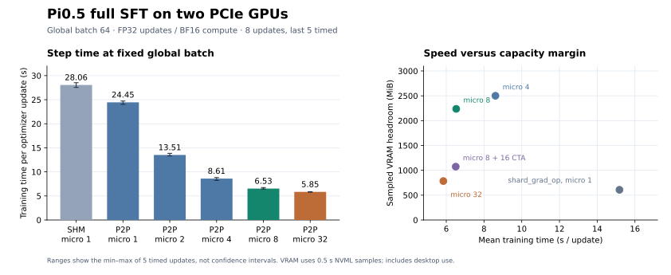
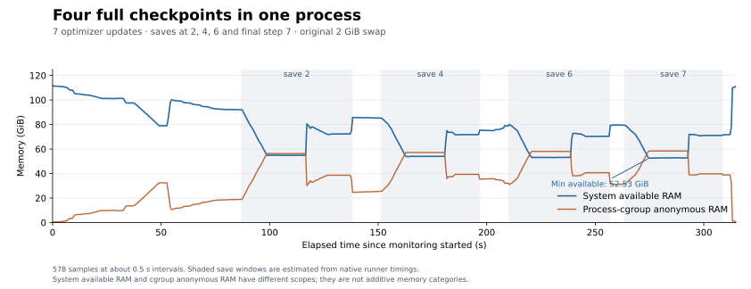

# SpiritAI π0.5 双卡全参数训练工程复盘

从这里查阅本次 SpiritAI 训练迁移、NVIDIA PCIe 调优、checkpoint 恢复和主机内存排查的结论，并取得可独立使用的正式训练命令。记录覆盖 2026-10-26 至 2026-10-27 的有限步数实验；正式长训练由人工启动，收敛曲线和真机任务成功率需要在后续实验中补充。

**2026-10-28 更新：** 正式首阶段在完成 506 步后，因 8 个 DataLoader 子进程的主机内存增长触发 Ray 95% 阈值而退出。原有短测未覆盖这一问题；下方配置仍是吞吐对照结果，完整 recipe 的长程稳定性需要修复后重验。重启前先阅读[故障复盘](2026-10-28-loader-memory-failure.md)。

已有[进程内空闲堆页回收修复](2026-10-28-worker-heap-reclaim.md)：真实数据压力验证覆盖每 worker 5000 个样本，超过原失败读取量，最低可用 RAM 为 99.59 GiB；另外通过 20 步双卡更新、保存、新进程恢复到 21 步及再次保存。数据压力测试不包含模型更新，仍需在人工启动的正式实验中观察长程趋势。

本机推荐为 **global batch 64、每卡 micro batch 8、FSDP1 `full_shard`、`NCCL_P2P_LEVEL=PHB`**。20 步确认运行排除前 3 步后平均为 **6.695 秒/步**，初始同 global batch 的基线为 **28.056 秒/步**，组合吞吐提高约 **4.19 倍**。完整保存、新进程恢复和同一进程连续 4 次保存均通过。所有配置使用全参数 FP32 更新、BF16 主干计算，调优通过现有配置和进程环境覆盖完成。

## 阅读顺序与证据

按下表区分历史阶段与当前推荐。历史报告中的参数和耗时保留为当时的实验条件，不应混用成一组性能比较。

| 记录 | 解决的问题 | 阅读时的边界 |
|---|---|---|
| [2026-10-26 smoke](2026-10-26-smoke.md) | 两张卡能否完成全参数前后向与更新 | global batch 2、5 步、state token 关闭、TensorBoard；只证明可运行 |
| [2026-10-27 训练预检](2026-10-27-preflight.md) | 数据迁移、W&B、global batch 32/64/128、保存恢复、离线 RTC | micro batch 1；两个更新的比较仅有一个预热后样本 |
| [2026-10-27 PCIe 与内存专项](2026-10-27-pcie-tuning.md) | 传输路径、micro batch、预取、CTA、主机 RAM/swap | 9 组受控训练对照、20 步确认及恢复、4 次连续保存；当前推荐的直接依据 |
| [2026-10-28 正式训练退出](2026-10-28-loader-memory-failure.md) | 506 步后的 DataLoader 主机内存增长与 Ray 终止 | 实际 5000 步运行失败；需要重验持续读取容量 |
| [2026-10-28 空闲堆页回收修复](2026-10-28-worker-heap-reclaim.md) | 可配置的进程内回收与精确数据恢复 | 真实数据验证每 worker 5000 个样本，保留长训练验证边界 |
| [中英文通用指南：中文](../../source-zh/rst_source/guides/openpi_pcie_sft.rst) / [English](../../source-en/rst_source/guides/openpi_pcie_sft.rst) | 在其他 PCIe 机器上复用排查与调优方法 | 数值来自本机个案，先验证新机器拓扑与容量 |
| [归档数据说明](artifacts/README.md) | 防止关键结论随本机日志清理丢失 | 小型 CSV、审计 JSON、配置快照和图表进入仓库；大权重留在本机 |

测试分支为 `feature/pi05-flow-only-full`，HEAD 为 `539a1428789abe6824111a87c3210e0b14c960f3`，加当时未提交的实现改动。**HEAD 单独不能重建被测代码。** [实验清单](artifacts/experiment_manifest.json)记录关键源文件、stats 和数据集 metadata 的 SHA-256；正式实验应固定完整代码版本，并保留实际解析后的配置。清单没有打包训练数据或基础权重。

## 迁移时固定了什么，改变了什么

这次迁移以 RLinf 的 JAX-aligned PyTorch 网络、FSDP、loss 和 RTC 实现为主，旧 `/home/deng/Documents/codebase/openpi/` 用于确认数据布局和训练历史。它是全参数 SpiritAI 训练实验，不是把旧 LoRA 配置逐项照搬后宣称等价。

| 项目 | 旧 `pi05_spiritai_cart_lora_h50_20260805_14annotations` | 本次正式运行计划 |
|---|---|---|
| 可训练参数 | Gemma/动作专家 LoRA | 约 3.35B 参数全量训练；LoRA 关闭 |
| 并行 | 旧单卡方案 | 两个 actor rank，FSDP1 `full_shard` |
| 当前 state | 本地配置 `discrete_state_input=false` | `true`，归一化 Cartesian state 与 prompt 一起编码为 token |
| 图像与动作 | 三路图像、25D Cartesian 数据、horizon 50 | 保留数据语义，动作 pad 至网络 32D；token 上限 256 |
| RTC | `rtc_training.enabled=true`、最大延迟 20 | 普通 flow-matching SFT；部署调用 RLinf 原生推理时 `approx` RTC |
| 学习率 | warmup 后 `2e-5` | warmup 后 `1e-5`；不是单独受控验证过的等价替换 |
| 样本预算 | batch 32 × 90000 steps | batch 64 × 45000 steps，等样本曝光量 |
| warmup / 保存 | 1500 / 5000 steps | 750 / 2500 steps，保持相同样本尺度 |
| logging | 旧项目自己的链路 | RLinf W&B backend，复用已有登录 |

这里的 state **不是额外的 joint-angle 向量**。当前 25D schema 是左臂 pose/psi/gripper 8D、右臂 8D、torso pose 6D、base velocity 3D。训练输入和目标来自这套 Cartesian 字段；数据集中存在 joint 列，并不意味着网络使用了它们。模型目标经过 padding 后交给 RLinf 原生 loss。真机 bridge 再将 25D 动作映射到 container 协商的 14/20/23D 布局。要引入 joint 输入，需同时定义字段、stats、token 预算及真机观测契约，不能只改一个总维度。

机器人通用部分位于 `rlinf/robotics/spiritai.py`、OpenPI 的 `policies/spiritai_policy.py` 和 `dataconfig/spiritai_dataconfig.py`。通用 recipe 名为 `spiritai_sft_openpi_pi05_full.yaml`；数据路径、stats、prompt 分布及 FoldBox 的 `zero_base_action_targets=true` 属于任务配置。当前通用 YAML 默认仍为保守的 batch 32 / micro 1，**实际推荐运行必须带上本页的 batch 64 / micro 8 覆盖**。

| 层 | 代码入口或文件 | 本次职责 |
|---|---|---|
| 训练入口和更新 | `examples/sft/train_vla_sft.py`、`FSDPVlaSftWorker`、`Pi0.compute_loss` | 复用原生 Ray actor、SFT runner、FSDP 和 flow loss |
| 机器人数据 | `policies/spiritai_policy.py`、`dataconfig/spiritai_dataconfig.py` | 映射命名字段、三相机、25D 布局和任务可选 flag |
| 数据恢复 | `official_sft_data_loader.py` | 可选 stateful loader，记录 sampler/worker RNG/变换签名 |
| checkpoint 接口 | `rlinf/workers/sft/fsdp_vla_sft_worker.py` | 接入已有 loader/RNG 保存恢复契约 |
| container 协议 | `rlinf/robotics/spiritai.py` | 共享字段定义、MessagePack/WebSocket、ACK 和动作维度协商 |
| 真机观测和执行 | `rlinf/envs/real/spiritai/cartesian.py` | 复用真实环境入口，对接现有 container |
| 实验选择 | SFT YAML、真实环境 YAML、`realworld_spiritai_eval_pi05_RTC.yaml` | 分开选择训练、机器人配置和推理时 RTC |

普通推理的首次调用约 6.16 秒，随后一次 RTC 调用约 0.252 秒；前者包含局部算子编译，因此不能据此声称 RTC 有数十倍加速。这组离线检查只证明真实记录观测能走通模型与 RTC 接口，实时延迟分布和真机控制效果需另测。

## 从“能跑”到“跑得快”的关键判断

先固定 global batch 再讨论加速。两卡的关系为 `global batch = 2 × micro batch × accumulation`：global 64 / micro 1 需要每卡 32 次前后向；micro 8 只需 4 次。把 global batch 改成 128、micro 仍为 1，会增加累积轮数，不能当成单次 GPU 计算批量变大。旧 smoke 的 1.36 秒/步与新 global 64 的秒/步也不能直接比较：处理量、state token 和配置均有差异。



图中受控对照均为 8 次更新，排除前 3 步后取 5 个样本，误差线表示最小到最大值，不是置信区间。GPU 占用来自每约 0.5 秒的 NVML 总量采样，包含桌面占用。显存余量图只覆盖这组运行，保存和恢复另有更高峰值。

有限测试使用恒定 `1e-5` 和 warmup 0，以便直接观察参数更新；正式计划使用 warmup 750。测试学习率不能误写为正式训练 schedule，也不能从这些短测推断优化质量。

| 观察 | 保留的判断 | 对应证据 |
|---|---|---|
| 两卡为 Gen5 ×16、同 NUMA 的 `NODE` 路径，读写 P2P 均可用；默认 NCCL 却使用 `SHM/direct` | 拓扑能力和实际 transport 必须分别核对 | NCCL Channel 日志；P2P 后变为 `P2P/IPC` |
| 同 micro 1，仅允许 PHB P2P 后 28.056 → 24.448 秒 | 可归于本次 transport 变更的耗时下降约 12.9% | 同条件 loss/grad-norm 记录一致 |
| P2P + micro 8 的 8 步均值为 6.526 秒；20 步确认均值为 6.695 秒 | 减少重复参数传输，并改善计算批量和调度开销 | [训练 CSV](artifacts/training_benchmarks.csv)；不能把全部收益归为 PCIe 带宽 |
| micro 32 为 5.846 秒，但峰值 48151 MiB；容量为 48935 MiB | 选择已验证保存/恢复的 micro 8 | 训练、保存和恢复要分别测显存 |
| backward prefetch 基本无收益；16 CTA 只带来约 0.4% 耗时差，却多占 1163 MiB | 本机保留默认预取和 CTA 自动选择 | 配置开关存在不等于本机一定更快 |
| `shard_grad_op` 的 micro 1 为 15.180 秒，峰值 48327 MiB | 更多参数驻留可省通信，但本机容量与速度综合不占优 | 同 micro 1 数值记录一致 |

不要混淆带宽单位和指标。26.7 **GB/s** 约为 214 **Gb/s**；PCIe Gen5 ×16 理论单向约 63.0 GB/s。实测单向 P2P Tensor 拷贝约 41.3–41.7 GB/s，而双 rank NCCL all-gather 的标准 bus bandwidth 为 algbw 的一半。固定 16 CTA 可将 256 MiB all-gather 微基准提高到约 29.7 GB/s，却没有带来相称的实际 SFT 收益。按端到端结果选择参数，保留微基准作为解释证据。[通信 CSV](artifacts/communication_benchmarks.csv)

## 保存、恢复和主机内存的闭环

完整 checkpoint 比可加载的模型权重包含更多内容。约 50 GiB 的目录包含约 12.5 GiB FP32 完整权重，以及模型分片、Adam 和 scheduler 状态；当前 SFT 路径另存 loader 与 RNG 状态。只验证 `full_weights.pt` 能推理，不能证明训练可恢复。

本次确认了 optimizer 的 665 个活跃 state 从 step 20 推进到 21，两个结构上未参与当前 action loss 的末层 prefix norm state 保持 0；每 rank 已消费的 micro batch 从 80 推进到 84；动作头、视觉 stem 和语言骨干代表性权重继续更新。不要对所有序列化 optimizer state 盲目断言同一个 step。当前没有做不中断 21 步与恢复运行的逐参数等价对照。[审计摘要](artifacts/validation_summary.json)



这组额外测试在原 2 GiB swap 下运行 7 步，第 2、4、6 步保存，最终第 7 步也自动保存，实际共 4 份。578 个约 0.5 秒样本中可用 RAM 最低为 52.53 GiB；匿名内存峰值约为 56.30、57.19、58.05、58.42 GiB。保存后明显回落，进程退出后可用 RAM 约为 111 GiB。存在约 2.1 GiB 的预热增长，不能据短测保证多天零增长，也不能据 `cached` 很大断言泄漏。

审计后删除这组 4 份临时输出，回收约 199.92 GiB 磁盘。系统可用 RAM 仅从 111.83 变到 111.94 GiB，而缓存约从 65 降到 15 GiB，说明这些缓存本来就可回收。正式 checkpoint 仍按 `global_step_*` 保留，当前 SFT runner 没有自动轮换删除逻辑；磁盘写满和 RAM 不足都可能表现为权重保存失败，需分别诊断。

文档归档时已观察到 `/swapfile` 2 GiB 加 `/swapfile-rlinf` 30 GiB，且 `/etc/fstab` 包含两项，总量约 32 GiB。这是测试之后的运维变更。需要在同样初始 2 GiB 状态的机器上复用时，可审阅并执行[归档脚本](artifacts/increase_swap_to_32g.sh)；已经是 32 GiB 的本机不需要再次运行。swap 为主机压力兜底，不能替代 RAM、修复泄漏或解决 CUDA OOM。

## 独立于本机日志目录的正式启动命令

以下命令直接调用仓库原生入口，避免依赖被 Git 忽略的两层本机启动脚本。路径是本次 FoldBox 任务的实际资产路径；迁移任务时替换数据、stats、实验名和任务相关 flags。执行前固定代码版本，并确认 W&B 登录使用的服务地址。

本轮目标是长时间双卡工程稳定性验证，在实际模型更新过程中持续观察主机内存、GPU/NCCL 通信、数据加载、吞吐和 checkpoint 写入，发现并定位类似 OOM 的工程问题。保存间隔保持 2500 步。

先在仓库目录进入已有 tmux 会话；新机器可以用 `tmux new-session -s spiritai-full` 创建：

```bash
cd /home/deng/Documents/codebase/RLinf
tmux attach-session -t spiritai-full
```

然后在 tmux 内手动执行正式首阶段。这里保留完整 45000 步 scheduler，先运行 5000 步：

```bash
set -o pipefail
export JAX_PLATFORMS=cpu
export PYTHONPATH="$PWD:${PYTHONPATH:-}"
export WANDB_BASE_URL=https://api.forge.coreweave.com
export NCCL_P2P_LEVEL=PHB
run_dir="$PWD/logs/$(date +%Y%m%d_%H%M%S)-spiritai_foldbox_pi05_full_bs64"
mkdir -p "$run_dir"

.venv/bin/python examples/sft/train_vla_sft.py \
  --config-name spiritai_sft_openpi_pi05_full \
  data.train_data_paths=/home/deng/Documents/dataset/20260805_FoldBox_SpiritAI_Moz1WB_14Annotations \
  actor.model.model_path=/home/deng/Documents/codebase/RLinf/model_checkpoints/pi05_base_rlinf_pytorch \
  actor.model.openpi_data.norm_stats_path=/home/deng/Documents/codebase/RLinf/model_checkpoints/foldbox_assets/norm_stats.json \
  actor.model.openpi_data.zero_base_action_targets=true \
  data.worker_malloc_trim_interval=64 \
  actor.global_batch_size=64 \
  actor.micro_batch_size=8 \
  runner.max_steps=5000 \
  actor.optim.total_training_steps=45000 \
  actor.optim.lr_warmup_steps=750 \
  runner.save_interval=2500 \
  runner.logger.log_path="$run_dir" \
  runner.logger.experiment_name=spiritai_foldbox_pi05_full_bs64 \
  2>&1 | tee "$run_dir/run.log"
```

`run.log` 保存原始输出，`pipefail` 保留训练进程的失败退出状态。`NCCL_P2P_LEVEL=PHB` 是本机测试过的拓扑覆盖；新机器先重复 P2P 能力和 transport 检查。`WANDB_BASE_URL` 与已有凭据的主机名一致，本次全局 CLI 与 venv SDK 默认服务地址不同，匹配地址后即可复用登录。文档和归档不包含凭据。

2026-10-28 修复后，SpiritAI recipe 默认每个数据子进程读取 64 个样本后回收 glibc 空闲堆页。保存间隔继续为 2500，5000 步首阶段在第 2500、5000 步保存，共约 100 GiB。后续恢复到总计 45000 步时继续使用相同保存间隔。

训练运行后按 `Ctrl+b`，松开后按 `d` 离开，使用同一 attach 命令返回。tmux 保留终端断连后的任务；机器重启、进程或整个 cgroup 被终止时仍依赖 checkpoint。恢复时在同一训练命令中把 `runner.max_steps` 改为 `45000`，并添加：

```text
+runner.resume_dir=/path/to/checkpoints/global_step_5000
```

保持 micro batch、worker 数、seed、rank 布局、数据及 stats 一致。`data.stateful_loader=true` 会检查恢复签名。恢复配置时应核对实际解析值，[修复后的配置快照](artifacts/formal_resolved_heap_reclaim.yaml)可作为对照；[原快照](artifacts/formal_resolved.yaml)保留内存回收修复前的配置，两者均每 2500 步保存。`--cfg job --resolve` 只解析配置，不启动训练。

## 预算、边界与下一次实验

样本曝光量为 `global batch × optimizer steps`。`32 × 90000 = 64 × 45000 = 128 × 22500 = 2880000` 个窗口；warmup 和保存间隔也按这个尺度换算。该预算继承自旧 LoRA 配置，并非已经证明的全参数收敛要求。按 20 步确认数据粗估，5000 步约 9.3 小时、45000 步约 3.5 天纯训练时间，另计保存、中断和长程波动。全程每 2500 步保存约有 18 份、900 GiB。

| 已证实 | 仍需后续实验 |
|---|---|
| 本机双卡完整更新、W&B、保存/恢复与连续保存 | 多天运行的内存趋势、训练曲线与任务效果 |
| 固定 global batch 下传输路径及 micro batch 的有限对照 | 多次重复统计、完整 GPU timeline、其他机器的最优配置 |
| 真实记录观测上的普通与 RTC 输出形状、有限值 | 真机 container 的现场联调、动作时序与任务成功率 |
| 当前数据与 stats 的适配和输入 schema | 新任务 prompt 长度、joint 输入扩展及新 stats 的验证 |

下一次复用时，先记录完整配置与版本，再按“传输路径 → micro batch → 全生命周期容量 → 受控步数 → 保存恢复 → 真机验证”的顺序推进。保留没有收益的设置和未执行的验证范围；它们同样能避免重复试错。本次记录由 AI assistant 协助整理与验证，正式训练和真机动作仍由人工操作。
