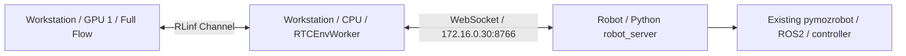

# SpiritAI Full Flow Robot Inference Runbook

Start the verified Full Flow + RTC robot path, select observation or action execution, and look up the purpose, default, and source of each manual setting. Each run loads one model on one GPU. Operators launch formal training and robot action commands manually. [中文](README.md)

As of 2026-11-19, the 45000-step Full Flow policy has completed a real-observation preview, a 50-tick robot check, and a 1500-tick robot run. The user confirmed that the inference chain works. The local logs below establish runtime behavior, not a quantitative folding-success rate.

| Run | Ticks | Effective mean rate | abort / close_error | Result |
|---|---:|---:|---|---|
| Observation preview | 300 | 25.62 Hz | 0 / 0 | Predicted actions without dispatch |
| Short robot check | 50 | 25.19 Hz | 0 / 0 | User observed robot motion; connection closed |
| Approximately one-minute robot run | 1500 | 25.42 Hz | 0 / 0 | 58.97 seconds from first to last tick; connection closed |

## Documentation Map

Choose a page by the operation you need. The original proposal is archived; use this runbook and parameter reference for current operation.

| Document | Contents |
|---|---|
| [Inference parameters](parameters.en.md) | Three common overrides, complete parameter tables, YAML locations, duration calculation, and precedence |
| [Robot deployment and troubleshooting](deployment.en.md) | Wired networking, Docker image, source mount, compatibility patch, preflight, W&B, and failures |
| [Implementation and verification](implementation.en.md) | RLinf ownership, assets, historical simulation checks, and 2026-11-19 hardware verification limits |
| [Hardware evidence](artifacts/realworld_full_flow_20261119.json) | Three runs, trace hashes, RTC latency, action and cleanup checks |
| [Original proposal](research-proposal.en.md) | Pre-development research, gaps and design evidence, preserving historical status |

## Machine Responsibilities

Start the SDK container on the robot, then RLinf on the workstation. The env worker owns the exclusive robot connection; let preflight release it before starting the policy.



The workstation uses `evaluations/run_eval.sh → EmbodiedEvalRunner → RTC workers → Pi0Eval`. Three images, 25D state, and an overall instruction condition actions; Full Flow disables Subtask Generation. A 50×32 model-space chunk becomes 50×25 decoded actions. Remove two psi values and send one 23D row per control tick. The container's 120 Hz dispatch layer, model queries, and nominal 30 Hz action timeline are separate rates.

## Check the Robot Service

The robot now runs `robot-server/0.3.1-rlinf-compat` using the existing `harbor.i.spirit-ai.com:443/shenming/thor-robot:0526` image. See [deployment](deployment.en.md) for source verification and update records. When a service start/restart is intended, run on the robot:

```bash
cd ~/robot_server_code
bash run_robot.sh
docker logs --tail 100 -f robot_server
```

Wait for `listening on ws://0.0.0.0:8766`. Ctrl+C in the log viewer only stops following logs; the detached container keeps running. Rerunning the script removes and recreates the named container, so use it when starting or restarting the service.

Check actual metadata, status, and three images from the workstation:

```bash
cd /home/deng/Documents/codebase/RLinf
.venv/bin/python -m toolkits.realworld_check.check_spiritai \
  --url ws://172.16.0.30:8766 --require-execution
```

Expect `cart_dim=23`, three `[240,320,3]` RGB images, `busy=false`, `execution_error=null`, and all three execution capabilities true. Preflight sends no actions and does not change following; `external_following_enabled` can already be true. These capability fields are additions made by this RLinf deployment adapter, not requirements of the original OpenPI bridge. Missing fields alone do not prove the underlying robot cannot operate; see the version investigation in [troubleshooting](deployment.en.md).

## Preview Real Observations

Run this complete command from the workstation repository root to predict 300 ticks from real observations. Weights and deployment bundles are prepared locally; retain the corresponding assets when moving machines as described in [implementation](implementation.en.md).

```bash
PATH="$PWD/.venv/bin:$PATH" \
bash evaluations/run_eval.sh realworld realworld_spiritai_eval_pi05_full_deploy \
  cluster.component_placement.rollout=1 \
  rollout.model.model_path="$PWD/logs/20261028_095838-spiritai_foldbox_pi05_full_bs64/spiritai_foldbox_pi05_full_bs64/checkpoints/global_step_45000" \
  rollout.model.openpi.deployment_metadata_path="$PWD/model_checkpoints/spiritai_deploy/flow_only/openpi_deployment.json" \
  rollout.model.openpi_data.norm_stats_path="$PWD/model_checkpoints/spiritai_deploy/flow_only/norm_stats.json" \
  runner.rtc.enabled=true \
  rollout.model.openpi.rtc_enabled=true \
  rollout.model.openpi.rtc_guidance_mode=approx \
  env.eval.override_cfg.robot_url=ws://172.16.0.30:8766 \
  env.eval.max_steps_per_rollout_epoch=300 \
  env.eval.max_episode_steps=300 \
  env.eval.override_cfg.execution_enabled=false \
  'runner.logger.logger_backends=[]'
```

It selects GPU 1, RTC scheduling, and `approx` sampler guidance while keeping `execution_enabled=false`. Trace `step` events represent preview control steps and do not dispatch or change following. Weight hashing/loading can take tens of seconds. Two warmup requests and bootstrap precede the control loop. Bootstrap has no old chunk, so guidance=false is expected; subsequent valid replans should report true.

## Execute for Approximately One Minute

Prepare the task starting pose and box position, then launch manually. With `execution_enabled=true`, actions begin after warmup and bootstrap without a keyboard start gate. Reset reads the current pose instead of moving to a demonstration preset.

```bash
PATH="$PWD/.venv/bin:$PATH" \
bash evaluations/run_eval.sh realworld realworld_spiritai_eval_pi05_full_deploy \
  cluster.component_placement.rollout=1 \
  rollout.model.model_path="$PWD/logs/20261028_095838-spiritai_foldbox_pi05_full_bs64/spiritai_foldbox_pi05_full_bs64/checkpoints/global_step_45000" \
  rollout.model.openpi.deployment_metadata_path="$PWD/model_checkpoints/spiritai_deploy/flow_only/openpi_deployment.json" \
  rollout.model.openpi_data.norm_stats_path="$PWD/model_checkpoints/spiritai_deploy/flow_only/norm_stats.json" \
  runner.rtc.enabled=true \
  rollout.model.openpi.rtc_enabled=true \
  rollout.model.openpi.rtc_guidance_mode=approx \
  env.eval.override_cfg.robot_url=ws://172.16.0.30:8766 \
  env.eval.max_steps_per_rollout_epoch=1500 \
  env.eval.max_episode_steps=1500 \
  env.eval.override_cfg.execution_enabled=true \
  'runner.logger.logger_backends=[]'
```

1500 counts control ticks, not seconds, policy queries, or training updates. At the observed 25.4 Hz, the action phase lasts about 59 seconds; loading, validation and warmup are additional. This is a step limit, not an exact 60-second wall-clock timer. Normal exit cancels further dispatch, attempts to release following, and closes the connection. Ctrl+C requests the same software cleanup and is not a hardware emergency stop.

## Why the Three Command Arguments Appear

These are Hydra runtime overrides, not observations supplied to the model. YAML defaults are merged first and command-line overrides apply last. Omit the three values when the YAML defaults suit the run.

| Parameter | Current deployment default | Reason for the example override |
|---|---|---|
| `env.eval.max_steps_per_rollout_epoch` | `3000`, from the env template | Worker control-loop budget per evaluation round; reduce it to 1500 |
| `env.eval.max_episode_steps` | `3000`, from the env template | Environment episode limit; truncate at the same 1500-tick boundary |
| `env.eval.override_cfg.execution_enabled` | `false`, from shared deployment settings | Explicitly permit robot dispatch; false selects observation preview |

The two limits need not be equal. With current `rollout_epoch=1` and `auto_reset=false`, the earlier limit normally ends the run: one bounds the outer loop, while the other produces an environment truncation/done. Setting both makes the round budget and episode boundary agree. See [parameters](parameters.en.md) for examples, divisibility requirements, and persistent YAML settings.

This update changes documentation only and preserves YAML defaults `3000 / 3000 / false`. Put run-length settings in `realworld_spiritai_eval_pi05_full_deploy.yaml` to omit their CLI arguments. Keeping the execution choice explicit makes motion commands easy to review.

## Inspect Results and Failures

`run_eval.sh` creates a directory per invocation. Terminal logs and detailed traces live at:

```text
logs/<timestamp>-realworld_spiritai_eval_pi05_full_deploy/eval_embodiment.log
logs/<timestamp>-realworld_spiritai_eval_pi05_full_deploy/spiritai_pi05_full_deploy/rtc-env-0.jsonl
```

Expect `rtc_aborted=0`, the intended tick count, final `closed`, and no `close_error`. A final `response_discarded: episode_limit` means an unfinished prediction was discarded at shutdown, not a fault. `Evaluating RTC Rollout: 8it` counts handled requests, not eight robot commands. The env has no automatic folding-success judge, so `reward=0 / success=0` does not establish inference failure.

Commands here disable optional cloud metrics with `runner.logger.logger_backends=[]`; terminal and RTC JSONL remain. Inference does not depend on W&B. To retain W&B, remove that override and set the endpoint matching this workstation's existing credential before launch:

```bash
export WANDB_BASE_URL=https://api.forge.coreweave.com
```

If `No API key configured` originates in `MetricLogger → wandb.init`, weights have not loaded yet. Check the endpoint rather than re-exporting weights or writing secrets into commands. See [deployment and troubleshooting](deployment.en.md) for networking, versions, capabilities, deadlines, and recovery.
