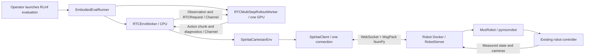

# SpiritAI inference bridge: research and implementation proposal

Use one native RLinf runtime to deploy the Full Flow and Explicit Subtask LoRA FoldBox policies. This proposal records the training assets, assigns model and robot responsibilities, and defines the implementation files and acceptance checks.

This document preserves the approved pre-development proposal. Planned statuses below refer to that research stage. Implementation is now authorized; see the [implementation record](implementation.en.md) for current behavior, verification and local commands. [中文](research-proposal.md) · [Research inventory](artifacts/research_inventory.json) · [Research documentation checks](artifacts/documentation_checks.json)

## Recommendation and existing foundation

Keep `evaluations/run_eval.sh → eval_embodied_agent.py → EmbodiedEvalRunner` as the launch path. The GPU rollout worker serves the policy, while the CPU env worker bridges observations and commands to the robot Docker server over its existing WebSocket protocol. Choose one policy per run, using one env worker, one rollout worker, and one GPU per robot. Full Flow and Subtask LoRA run separately and are not loaded together.

Current `main` (`f1d402ae`) already contains most of this runtime: [RTCEnvWorker](../../../rlinf/workers/env/rtc_env_worker.py), [RTCMultiStepRolloutWorker](../../../rlinf/workers/rollout/hf/rtc_huggingface_worker.py), [SpiritaiCartesianEnv](../../../rlinf/envs/real/spiritai/cartesian.py), and [SpiritaiClient](../../../rlinf/robotics/spiritai.py). The main work is to provide a complete Full Flow deployment profile and validation path, then unify startup and checks for both policies.

A separate OpenPI WebSocket policy server is not required by this topology. Model inference continues to use RLinf's `Pi0Eval`, transforms, and Flow sampler. The Robot SDK stays inside the robot Docker container; the workstation does not instantiate `pymozrobot`.

## Verified training assets

Use the local W&B resolved configuration and launch metadata together with checkpoint records. Full Flow's final continuation is `run-20261113_104028-8jehu52t`; the initial 5000-step run does not describe the final training schedule.

| Item | Full Flow | Explicit Subtask LoRA |
|---|---|---|
| Run root | `logs/20261028_095838-spiritai_foldbox_pi05_full_bs64` | `logs/20261102_233335-pi05_subtask_lora_bs64` |
| Final W&B files, relative to run root | `wandb/wandb/run-20261113_104028-8jehu52t/files` | `wandb/wandb/run-20261102_233413-zs6f942j/files` |
| Configuration and launch records | Both `config.yaml` and `wandb-metadata.json` exist | Both `config.yaml` and `wandb-metadata.json` exist |
| Last recorded `_step` | 44999, checked against `global_step_45000` | 44999, checked against `global_step_45000` |
| Embedded training metadata | No `actor/openpi_training.json` | Present, `text_template_version=1` |
| Raw weight structure | 667 FP32 tensor entries; no LoRA entries | 1279 FP32 tensor entries; 612 names contain `lora_`, including scaling buffers |
| Deployment form | Native loader reads `full_weights.pt` directly | Load complete weights after merging adapters; runtime `is_lora=false` |
| Existing merged export | No adapter merge needed | A 45000-step export exists with 667 tensor entries |

Both resolved training configurations record global batch 64, micro batch 8, three images, 25D environment actions, 32D model actions, horizon 50, state tokens enabled, text length 256, FP32 parameters, and BF16 embedding computation. Keep the recorded training `num_steps=5` separate from the proposed deployment choice of ten sampler steps. LoRA also has explicit hierarchy and CE/FM weights, preserved in the inventory.

Full Flow weights:

```text
logs/20261028_095838-spiritai_foldbox_pi05_full_bs64/
  spiritai_foldbox_pi05_full_bs64/checkpoints/global_step_45000/
    actor/model_state_dict/full_weights.pt
```

Raw LoRA weights:

```text
logs/20261102_233335-pi05_subtask_lora_bs64/
  spiritai_pi05_subtask_ce_flow_lora_bs64_45000/checkpoints/global_step_45000/
    actor/model_state_dict/full_weights.pt
```

Existing merged LoRA deployment assets:

```text
logs/20261102_233335-pi05_subtask_lora_bs64/
  offline_eval_20261110_163331/exports/step_45000/
```

CPU mmap inspection found identical tensor names, shapes, and dtypes in Full Flow and merged LoRA. They can share model construction and loading. This does not imply equal weight values or control performance. No model forward pass was run in this research round; historical single-GPU LoRA checks are recorded in the [existing deployment notes](../pi05-explicit-subtask-ce-lora/deployment.md).

Full Flow's `data.pt` records the normalization file SHA256, which matches the current file. Its normalization content also matches the content saved in the LoRA checkpoint. A W&B Git SHA identifies the recorded HEAD but does not establish that the historical working tree was clean. Preserve configurations, checkpoint metadata, and asset fingerprints together.

## Runtime and ownership

Keep model inference and robot communication in the existing two workers so either policy runs under the same control conditions. Only the workstation runs RLinf; the robot Docker container is not a Ray node.



| Component | Responsibility | Responsibility owned elsewhere |
|---|---|---|
| `Pi0Eval` | Transforms, optional Subtask Generation, existing Flow sampler, action decoding | Robot connection, thread scheduling, SDK calls |
| Rollout worker | One model instance, serialized inference, planner cache, model-space RTC tail, inference diagnostics | Sending commands to the robot |
| Env worker / `RTCSession` | Session and request identity, one in-flight request, deadlines, action indexing, termination | New model architecture or Flow Matching implementation |
| `SpiritaiCartesianEnv` | Measured state, action limits, tick dispatch, following lifecycle | Learned stage planning |
| `SpiritaiClient` | Encoding, request IDs, RPC deadlines, capability checks, exclusive robot connection | Another command queue or inferred SDK units |
| Robot Docker | Cameras, SDK, actual execution completion and errors, cancellation of further dispatch | Policy loading or high-level planning |

## Separate policy input contracts

A shared bridge must still declare each policy's text conditioning explicitly. Neither a checkpoint name nor its tensor schema establishes whether high-level generation should run.

| Mode | Inference data flow | Initialization and cache |
|---|---|---|
| `flow_only` | Three current images + 25D state + overall instruction → Flow action chunk | Disable hierarchy; do not call `sample_subtask_tokens` |
| `explicit_subtask` | Current observation + overall → autoregressive Subtask; current observation + generated text → Flow action chunk | Reset the planner each episode; reuse the existing `SubtaskPlanningState` for lower-frequency planning |

Full Flow training task examples contain `overall + Current step`, while the established baseline uses only overall at inference. Preserve that experiment definition and record the conditioning difference. Do not inject human or ground-truth Subtasks into the baseline. Entry zero in the original `tasks.jsonl` is `unknown`, so it cannot supply a deployment instruction; use a verified task instruction.

Subtask LoRA retains the current implementation: rebuild separate HL and LL text contexts, reject an action if generation reaches the token limit without EOS, and disable previous-chunk RTC guidance when the Subtask changes. `planning_interval=3` counts three action requests, not three seconds or three control ticks.

## Observation, action, and timing contracts

Fix representations to match training before changing transport or limits. Keep model-space and robot-space actions separate; a normalized 32D tensor is not a robot command.

| Data | Representation and source |
|---|---|
| Images | `cam_high`, `cam_left_wrist`, `cam_right_wrist`; current robot launcher outputs 320×240 RGB, then the model transform produces 224×224 |
| State | 25D: left pose6, psi, gripper; the same for the right arm; torso pose6; base3 |
| Model action | `[1, 50, 32]`, retained in normalized model space for RTC overlap |
| Decoded policy action | `[1, 50, 25]`, decoded with the checkpoint's training statistics |
| SDK wire action | Remove the two psi values to produce 23D; retain torso and force base to zero |
| Orientation | Local server uses rotation vectors and SLERP; verify the physical SDK frame and units on site |
| Rates | Dataset and bridge use 30 Hz; the model replans by chunk; 120 Hz belongs to the server/controller |

The client can also fall back to 20D or 14D. FoldBox is a whole-body policy, so the new deployment should require the complete body/state contract by default. A 20D endpoint needs confirmation that it omits only the zero base; silently falling back to 14D would lose torso commands.

Retain current SO(3), translation-speed, and zero-base limits. The gripper range `[0, 0.1]` is an engineering range from demonstration data, not a verified SDK specification. Confirm measurement and command units and direction. The container already rotates camera images; the client must not rotate them again.

## Verified gaps and proposed remedies

The historical Full RTC YAML is not a verified Full Flow deployment profile.

| Evidence | Effect | Proposed remedy |
|---|---|---|
| Full RTC composes with precision=null, two images, 480×640, and no explicit bounded/preview settings | It differs from three-image training and current camera output; the class default can execute actions | Add a Full Flow deployment primary sharing a settings fragment with LoRA |
| `validate_deployment=true` calls only `validate_hierarchical_deployment` | Turning hierarchy off is insufficient to validate Full Flow | Dispatch by explicit policy kind; use traceable W&B/loader metadata for Full and retain strict LoRA validation |
| Native loader resolves `global_step/actor/model_state_dict/full_weights.pt` | Full needs no conversion to the old OpenPI `paligemma_with_expert.*` layout | Load native consolidated Full weights directly; optional packaging copies assets and provenance |
| Actual local `resample(T=1)` raises `ValueError: x must contain at least 2 elements` | This source cannot execute the bridge's single-row command | Verify the deployed version, then implement a single absolute-target path without fabricating duration by duplicating targets |
| ACK precedes background execution; busy uses an estimated finish time | Acceptance does not establish execution success | Track the real Future and expose SDK errors and command status |
| `cancel_actions()` is `pass`; hello has no execution capabilities | Disconnect does not establish cancellation; strict deployment rejects execution | Review the existing compatibility patch; cancel further SDK sends and wait for actual completion |
| Control ticks, GPU queries, and network calls have different timing | Fitting the model on one GPU does not establish real-time performance | Measure cold start, HL+LL, LL-only, RPC, and actual ticks; report P95/P99 and deadline misses |
| Non-hierarchical `guidance_applied` can inherit a request-level default | Diagnostics can report guidance even when the model disables it | Report the actual sampling path in both modes; distinguish RTC scheduling from sampler guidance |
| Ray/process exit may bypass a remote env's Python `finally` | Ctrl-C, process exit, and robot cancellation need a verified handoff | Audit signal handling and test controlled stop and container disconnect cancellation; do not treat kill-9 as normal shutdown |

Local robot source SHA256 values match the unpatched source recorded in the older compatibility manifest. The running container may differ. The existing [compatibility patch](../pi05-explicit-subtask-ce-lora/artifacts/robot_server_compat.patch) was tested only in a temporary copy; adding `capability=true` alone cannot establish correct execution behavior.

## Planned file locations

Keep shared runtime in `rlinf/` and model/device choices in evaluation configuration. This work spans both experiments, so the proposal belongs in `docs/experiments/spiritai-inference-bridge/`.

| Path | Status | Planned role |
|---|---|---|
| `evaluations/run_eval.sh`, `evaluations/eval_embodied_agent.py` | Existing; reuse | Official entry point using native Cluster, placement, runner, and workers |
| `evaluations/realworld/_spiritai_pi05_deploy.yaml` | Proposed | Shared settings only: BF16, three images, bounded RTC, observer default, cameras and limits; no duplicate defaults chain |
| `evaluations/realworld/realworld_spiritai_eval_pi05_full_deploy.yaml` | Proposed | Static Full Flow settings, explicit hierarchy=false, metadata/provenance selection |
| `evaluations/realworld/realworld_spiritai_eval_pi05_subtask_deploy.yaml` | Existing; adjust inheritance | Shared deployment settings with HL/LL-specific parameters |
| `rlinf/models/embodiment/openpi/checkpoint.py` | Existing; extend | Common deployment validation dispatch with compatibility for the hierarchical helper |
| `rlinf/utils/ckpt_convertor/openpi/merge_lora.py` | Existing; reuse | Adapter merge and metadata/statistics export; prevent a second merge of already merged weights |
| `rlinf/utils/ckpt_convertor/openpi/prepare_deployment.py` | Proposed thin tool | Read W&B/checkpoint records and write provenance; no Full algorithm or weight-layout conversion |
| `rlinf/workers/env/rtc_env_worker.py`, `rtc_control.py`, `rlinf/runners/embodied_eval_runner.py` | Existing; audit and complete where needed | Shared scheduling, stopping, draining/discarding stale replies, and logs |
| `rlinf/workers/rollout/hf/rtc_huggingface_worker.py` | Existing; correct diagnostics where needed | Actual inference diagnostics for both hierarchy modes |
| `rlinf/robotics/spiritai.py`, `rlinf/envs/real/spiritai/cartesian.py` | Existing; reuse and check | Protocol, observations, limits, and connection ownership; do not copy these into a separate bridge |
| `toolkits/realworld_check/check_spiritai.py` | Proposed | Read-only preflight using `SpiritaiClient`; release the exclusive connection afterward |
| `tests/unit_tests/test_models.py`, `test_data.py`, `test_real_env.py`, `test_robotics.py` | Existing; extend by responsibility | Modes/metadata, messages/cache, control, and protocol contracts |
| `tests/e2e_tests/evaluations/` | Existing directory; add integration coverage | Real RLinf workers and robot server with SDK/camera fakes at the external boundary |
| `model_checkpoints/`, `logs/` | Existing local asset directories | Optional deployment bundles and evaluation logs; keep weights and frame data out of Git documentation |

The preparation tool should record source checkpoint, step, training configuration and launch files with hashes, policy kind, normalization content/fingerprint, and required runtime dimensions. Mark Full provenance as reconstructed from surviving training records, rather than inventing a historical `openpi_training.json`. Preserve LoRA's original metadata; deployment must not rewrite its historical `is_lora=true` field.

## Implementation sequence

First support both models through the same entry point, then verify on site. Unconfirmed deployed robot details do not prevent repository implementation and simulation checks.

| Phase | Work | Completion condition |
|---|---|---|
| P1: Assets and inputs | Common provenance, native Full loading, existing merged LoRA, verified overall and statistics | Reject mode/dimension/normalization mismatches before enabling following |
| P2: Deployment profiles | Two primary configs and one shared fragment; one GPU, BF16 and existing FP32 islands | Compose/resolve both through the actual CLI and load their 45000-step weights |
| P3: Control and shutdown | Existing bounded session, actual guidance reporting, controlled exit | Zero actions on warmup failure; defined termination for late/mismatched replies, exhaustion, and disconnect |
| P4: Robot protocol | Compare deployed code/metadata and verify necessary patch and SDK contracts | Actual code supports single rows, completion status, execution errors, and cancellation |
| P5: Offline/loopback | Test each policy on one GPU with real workers and a simulated robot server | Automated acceptance checks pass with traceable logs |
| P6: On-site observation and short execution | Operator performs read-only preflight before explicitly enabling execution | Verify cameras, units, frames, deadlines, and stopping before evaluating folding |

Initially keep observation as the default. An operator-selected execution mode starts motion only after warmup. If keyboard start/stop is added, waiting must only read observations; the old idle wrapper sends hold commands and cannot be reused unchanged. Control messages stay on existing RLinf Channels instead of creating a separate SDK thread.

## Timing budget and comparability

Start both policies with horizon 50, ten Euler steps, 30 Hz control, identical camera order, statistics, and limits. Ten is the existing deployment sampling choice; training metadata's `num_steps=5` does not mandate five inference steps. Preserve existing FP32 islands rather than forcing every module to BF16.

`runner.rtc.enabled=true` selects asynchronous workers. Model-side `openpi.rtc_enabled` controls sampler `approx` guidance. A diagnostic with guidance disabled should retain the asynchronous controller to avoid changing two mechanisms together. This deployment adds no `training_time_v1` objective to either policy.

The existing 1.2-second replan budget, 30-second bootstrap/warmup timeout, and two warmup rounds are starting values that need separate measurement for Full and LoRA. During execution, also require `inference delay + communication margin < (H - current action index) / source_hz`. A reply may have already lost much of its prefix; do not assume forty rows remain. Repeating the last target indefinitely must not hide deadline failures.

Log checkpoint identity and policy kind, generated text/EOS/cache age, HL/LL/total latency, RPC and actual tick timing, late/discard reasons, model-space tail, commands before/after limits, measured state, and shutdown results. Sample images and large arrays only when needed so logging does not disrupt control timing.

## Acceptance criteria and verification limits

These are requirements for development, not model tests completed in this research round. Current evidence covers W&B/metadata, CPU tensor schemas, configuration composition, and a pure interpolation function. Historical tests remain separate.

| Check | Required observation |
|---|---|
| Models and metadata | Finite `[1,50,25]` outputs from Full and merged LoRA; no HL for Full; correct EOS and independent LL context for LoRA; reject wrong statistics/modes |
| Episode isolation | Replan for a new episode even with the same overall; reject old-session/chunk replies |
| Native protocol | Real server/interpolation code accepts a single row; SDK failure remains detectable after ACK; busy follows actual completion |
| Observer | Neither policy's preview sends actions or changes following; preflight releases the exclusive connection |
| Control failure | Warmup/initial inference failure sends no step or hold; runtime timeout stops prediction use, attempts bounded measured holds, then closes |
| Exit | Test controlled stop, Ctrl-C, model error, and socket timeout cleanup; cancellation prevents further SDK rows without claiming motor emergency-stop semantics |
| Short run and soak | At least 300 integration ticks per profile, followed by at least ten minutes of simulated soak; measure cold/steady inference, HL cache hits/misses, and deadline misses |
| Result interpretation | Assert the intended trace stage and stop state in fault tests; a nonzero exit code alone is insufficient; satisfy runner step-divisibility constraints |
| Code and docs | Component tests, relevant CI path filters, Ruff, bilingual docs, and traceable provenance pass |

Run Ray-worker test files serially and export the repository, `tests`, and `tests/unit_tests` on worker PYTHONPATH. Where CI lacks weights or robot hardware, state local GPU/hardware validation limits. Operators continue to launch formal training and real robot execution manually.

## Scope after confirmation

This proposal does not change training objectives, datasets, batch sizes, or weights, and it adds no KI, FAST CE, implicit planner, or new Flow implementation. The running container version, SDK pose/gripper units and frames, and actual network latency still need on-site confirmation. Tensor schemas and low training loss cannot resolve those questions.

After confirmation, implementation covers a native RLinf bridge shared by both policies. Keep research in this cross-experiment directory and update the existing EN/ZH `evaluations/guides/realworld.rst` operating guide when the functionality exists.
