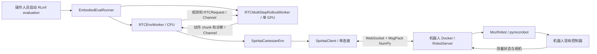

# SpiritAI 统一推理 Bridge：调研与实施方案

用本方案将 Full Flow 与 Explicit Subtask LoRA 两种 FoldBox policy 接入同一个 RLinf 真机推理链路。先核对训练资产，再确定模型、控制与机器人通信的职责，最后按文件位置和验收条件实施。

本文保留开发前获批方案，下文“拟新增/拟修改”描述当时的计划。用户已批准实施；当前实现、验证结果和本机命令见[实施记录](implementation.md)。[English](research-proposal.en.md) · [研究阶段核查清单](artifacts/research_inventory.json) · [研究阶段文档检查](artifacts/documentation_checks.json)

## 结论与当前基础

推荐以现有 `evaluations/run_eval.sh → eval_embodied_agent.py → EmbodiedEvalRunner` 为正式启动入口，由 GPU 上的 rollout worker 承担 policy server 职责，CPU 上的 env worker 承担 bridge 职责，通过现有 WebSocket 访问机器人 Docker。每次只选择 Full Flow 或 Subtask LoRA 中的一种，一个机器人使用一个 env worker、一个 rollout worker 和一张 GPU。两种模型分别启动，不同时加载或运行。

当前 `main`（`f1d402ae`）已经包含这条链路的大部分实现：[RTCEnvWorker](../../../rlinf/workers/env/rtc_env_worker.py)、[RTCMultiStepRolloutWorker](../../../rlinf/workers/rollout/hf/rtc_huggingface_worker.py)、[SpiritaiCartesianEnv](../../../rlinf/envs/real/spiritai/cartesian.py) 和 [SpiritaiClient](../../../rlinf/robotics/spiritai.py)。本轮需要补齐 Full Flow 的部署配置和 metadata 校验，将两类 policy 的启动与检查统一起来。

独立的 OpenPI WebSocket policy server 不是推荐拓扑的必需组件。模型推理仍使用 RLinf 的 `Pi0Eval`、现有 transform 和 Flow sampler；Robot SDK 保留在机器人 Docker 内，工作站不直接实例化 `pymozrobot`。

## 两类训练资产已经核对到什么程度

优先使用本地 W&B 的真实 resolved config 和启动 metadata，配合 checkpoint 自带信息还原部署条件。Full Flow 的最终续训记录在 `run-20261113_104028-8jehu52t`，不能把最早 5000 步阶段的配置当成最终训练计划。

| 项目 | Full Flow | Explicit Subtask LoRA |
|---|---|---|
| 运行根目录 | `logs/20261028_095838-spiritai_foldbox_pi05_full_bs64` | `logs/20261102_233335-pi05_subtask_lora_bs64` |
| 最终 W&B 文件目录 | `wandb/wandb/run-20261113_104028-8jehu52t/files` | `wandb/wandb/run-20261102_233413-zs6f942j/files` |
| config / 启动记录 | `config.yaml`、`wandb-metadata.json`，均存在 | `config.yaml`、`wandb-metadata.json`，均存在 |
| 最后记录的 `_step` | 44999，配合 `global_step_45000` 核对 | 44999，配合 `global_step_45000` 核对 |
| checkpoint 内嵌训练 metadata | 没有 `actor/openpi_training.json` | 有，`text_template_version=1` |
| 原始权重结构 | 667 个 FP32 tensor entry，没有 LoRA entry | 1279 个 FP32 tensor entry，其中 612 个名称含 `lora_`，包含 scaling buffer |
| 部署形式 | 原生 loader 直接读取 `full_weights.pt` | adapter 合并后读取完整权重，运行时 `is_lora=false` |
| 已有合并导出 | 无需 adapter 合并 | 已有 45000-step 导出，667 个 tensor entry |

两次训练的 resolved config 均记录：global batch 64、micro batch 8、3 路图像、25D 环境动作、32D 模型动作、horizon 50、state token 开启、文本长度 256、FP32 参数与 BF16 embedding 计算。训练记录中的 `num_steps=5` 与后文计划沿用的部署采样步数 10 分别保存，避免把部署选择误写成训练事实。LoRA 另有明确的 hierarchy 配置和 CE/FM 权重，见核查清单。

Full Flow 原始权重位于：

```text
logs/20261028_095838-spiritai_foldbox_pi05_full_bs64/
  spiritai_foldbox_pi05_full_bs64/checkpoints/global_step_45000/
    actor/model_state_dict/full_weights.pt
```

LoRA 原始权重位于：

```text
logs/20261102_233335-pi05_subtask_lora_bs64/
  spiritai_pi05_subtask_ce_flow_lora_bs64_45000/checkpoints/global_step_45000/
    actor/model_state_dict/full_weights.pt
```

已合并的 LoRA 部署目录位于：

```text
logs/20261102_233335-pi05_subtask_lora_bs64/
  offline_eval_20261110_163331/exports/step_45000/
```

CPU mmap 检查证明 Full Flow 与已合并 LoRA 的 tensor 名称、shape 和 dtype 一致，可以复用同一种模型构造与加载方式。这不表示权重数值相同，也不证明两者的控制性能。本轮没有运行模型 forward；历史 LoRA 单 GPU 验证记录见[已有部署文档](../pi05-explicit-subtask-ce-lora/deployment.md)。

Full Flow 的 `data.pt` 记录了原始 normalization 文件 SHA256，本次与现文件匹配；它的 normalization 内容也与 LoRA checkpoint 保存的内容一致。W&B 中的 Git SHA 只表示记录到的 HEAD，不能单独证明历史工作区干净，必须同时保留配置、checkpoint metadata 和资产指纹。

## 统一链路与各组件的职责

把模型推理和机器人通信保持在现有两个 worker 中，就能在同一控制条件下切换两类 policy。机器人 Docker 不加入 Ray cluster，只有工作站运行 RLinf。



| 组件 | 应保留的职责 | 不应放入该组件的职责 |
|---|---|---|
| `Pi0Eval` | 输入 transform、可选 Subtask Generation、现有 Flow sampler、动作解码 | 机器人连接、线程调度、SDK 调用 |
| rollout worker | 持有一份模型、串行推理、planner cache、model-space RTC 尾部和推理诊断 | 直接向机器人发送动作 |
| env worker / `RTCSession` | session 与 request 身份、单个在途请求、时间预算、动作索引与退出 | 新模型架构或重新实现 Flow Matching |
| `SpiritaiCartesianEnv` | 实测状态、动作限幅、按 tick 下发、following 生命周期 | 学习到的阶段推理 |
| `SpiritaiClient` | 编解码、request ID、RPC deadline、能力检查、唯一机器人连接 | 另建控制队列或猜测 SDK 单位 |
| 机器人 Docker | 相机、SDK、执行完成与错误状态、取消后续下发 | 加载 policy 或执行高层规划 |

## Policy 的输入契约必须分开

共享 bridge 不代表共享相同的文本条件。切换 policy 时，明确声明它是否执行高层生成，不能靠 checkpoint 文件名或相同 tensor shape 猜测。

| 模式 | 推理数据流 | 初始化与缓存 |
|---|---|---|
| `flow_only` | 当前三路图像 + 25D state + overall → Flow action chunk | 关闭 hierarchy，不调用 `sample_subtask_tokens` |
| `explicit_subtask` | 当前观测 + overall → 自回归 Subtask；当前观测 + 生成文本 → Flow action chunk | 每个 episode 重置 planner；低频缓存沿用 `SubtaskPlanningState` |

Full Flow 的训练 task 样例含 `overall + Current step`，而既定 baseline 推理使用 overall。方案保留这一实验定义并记录训练/推理条件差异，不向 baseline 自动注入人工或 GT Subtask。原始 `tasks.jsonl` 第 0 项为 `unknown`，不能把第一项直接当部署指令；部署 overall 使用已核对的任务文本。

Subtask LoRA 沿用当前实现：HL 与 LL 重建各自文本 context；达到 token 上限但没有 EOS 时拒绝动作；Subtask 改变后停用上一 chunk 的 RTC guidance。`planning_interval=3` 是三个 action request，不是三秒或三个执行 tick。

## 观测、动作与时间应如何传递

先固定和训练一致的表示，再处理通信与限幅。model-space 动作与机器人动作分别保存，不能把归一化后的 32D tensor 直接发送给 SDK。

| 数据 | 表示与来源 |
|---|---|
| 图像 | `cam_high`、`cam_left_wrist`、`cam_right_wrist`；当前 robot launch 输出 320×240 RGB，模型 transform 处理为 224×224 |
| state | 25D：左臂 pose6、psi、gripper；右臂同结构；torso pose6；base3 |
| model action | `[1, 50, 32]`，保持在模型归一化空间，用于 RTC overlap |
| 解码后的 policy action | `[1, 50, 25]`，使用各 checkpoint 对应的训练 stats 解码 |
| SDK wire action | 删除两个 psi，形成 23D；包含 torso 和强制为零的 base |
| 姿态 | 本地 server 按 rotation vector 使用 SLERP；SDK 的实际参考系和单位仍需现场核实 |
| 控制频率 | 数据和 bridge 采用 30 Hz；模型按 chunk 重规划；120 Hz 是 server/底层控制频率 |

当前 client 也支持降级到 20D 或 14D，但 FoldBox 是 whole-body policy：新部署默认要求完整的 body/state 契约；20D 需确认只省略零 base，不能静默退到会丢弃 torso 的 14D。

保留现有 SO(3) 旋转限幅、平移速度限幅和 base=0。夹爪 `[0, 0.1]` 是示范数据中的工程范围，尚不能当成 SDK 规格；必须核对 state/command 是否同单位、同方向。相机旋转已由 container 执行，client 不重复旋转。

## 当前差距与必须处理的风险

以下区分已验证事实和拟补齐能力。旧版 Full RTC YAML 是历史配置，不能直接作为已验证的 Full Flow 部署入口。

| 现状证据 | 对统一 bridge 的影响 | 拟处理方式 |
|---|---|---|
| Full RTC compose 结果：precision=null、图像数=2、480×640；没有 bounded/preview 的显式配置 | 与实际训练三路图像和当前相机输出不一致；class 默认还可能执行动作 | 新增 Full Flow deployment primary，与 LoRA 共享部署参数片段 |
| `validate_deployment=true` 目前只调用 `validate_hierarchical_deployment` | 把 hierarchy 改成 false 仍不能正确校验 Full Flow | 按明确的 policy kind 分派校验；Full 读取可追溯的 W&B/loader metadata，LoRA 保留已有严格校验 |
| 原生 loader 能解析 `global_step/actor/model_state_dict/full_weights.pt` | Full 不需要转换为旧 OpenPI 的 `paligemma_with_expert.*` 布局 | 直接加载 Full 原始 consolidated 权重；可选包装只复制资产和 metadata |
| 本地 server `resample(T=1)` 实测报 `ValueError: x must contain at least 2 elements` | 当前 bridge 的单行动作不能在该源码上正常执行 | 先核对部署版本，再修正单行绝对目标执行语义；不靠重复目标伪造轨迹时长 |
| server 的 ACK 先于后台执行，busy 仅使用预计结束时间 | 接收确认不能证明动作执行成功 | 跟踪真实 Future 完成，暴露 SDK error 和 command 状态 |
| `cancel_actions()` 为 `pass`，hello 未声明执行能力 | 断连不能证明停止，当前严格部署会拒绝执行 | 复核既有兼容补丁；取消必须停止后续 SDK send 并等待实际任务结束 |
| renderer/tick、GPU query 和网络是不同时间尺度 | 单 GPU 能容纳模型不等于达到实时要求 | 分别测量冷启动、HL+LL、仅 LL、RPC 和实际 tick，记录 P95/P99 与 deadline miss |
| 非 hierarchical 路径的 `guidance_applied` 可能沿用 request 层默认值 | 关闭模型 guidance 时日志可能误报 | 统一从模型实际采样路径报告 guidance，区分 RTC 调度与采样 guidance |
| Ray/进程退出未必执行远端 env 的 Python `finally` | Ctrl-C、进程退出和机器人取消之间需要可验证的交接 | 审计现有 signal 处理，验证受控 stop 和 container 断连取消；不把 kill-9 当正常退出 |

机器人本地源码 SHA256 与旧补丁 manifest 的“未修复源文件”一致；机器人上运行的容器可能不同，不能据本地源码断言线上行为。现有[兼容补丁](../pi05-explicit-subtask-ce-lora/artifacts/robot_server_compat.patch)只在临时副本验证，不能仅补一个 capability=true 标志来绕过执行检查。

## 实施时文件放在哪里

把公共 runtime 保留在 `rlinf/`，模型和设备选择放在 evaluation 配置中。调研与对照属于两个实验共用的工程工作，因此本方案放在 `docs/experiments/spiritai-inference-bridge/`。

| 路径 | 状态 | 计划职责 |
|---|---|---|
| `evaluations/run_eval.sh`、`evaluations/eval_embodied_agent.py` | 已有，复用 | 唯一正式启动入口，仍构建原生 Cluster、placement、runner 和 workers |
| `evaluations/realworld/_spiritai_pi05_deploy.yaml` | 拟新增 | 纯公共参数片段：BF16、3 图、bounded RTC、只读默认、相机/限幅；不引入重复 defaults 链 |
| `evaluations/realworld/realworld_spiritai_eval_pi05_full_deploy.yaml` | 拟新增 | Full Flow 的静态参数、显式 hierarchy=false、metadata/provenance 选择 |
| `evaluations/realworld/realworld_spiritai_eval_pi05_subtask_deploy.yaml` | 已有，调整继承 | 使用同一公共部署片段，保留 HL/LL 专有设置 |
| `rlinf/models/embodiment/openpi/checkpoint.py` | 已有，扩展 | 统一部署校验入口，保留原 hierarchical helper 的兼容行为 |
| `rlinf/utils/ckpt_convertor/openpi/merge_lora.py` | 已有，复用 | LoRA 合并与原 metadata/stats 导出；禁止重复合并已合并权重 |
| `rlinf/utils/ckpt_convertor/openpi/prepare_deployment.py` | 拟新增，薄工具 | 读取本地 W&B 与 checkpoint metadata，生成部署 provenance；Full 不做算法或权重布局转换 |
| `rlinf/workers/env/rtc_env_worker.py`、`rtc_control.py`、`rlinf/runners/embodied_eval_runner.py` | 已有，审查和必要补齐 | 两类 policy 共用调度、停止、排空/丢弃旧回复和日志 |
| `rlinf/workers/rollout/hf/rtc_huggingface_worker.py` | 已有，必要修正 | 统一非 hierarchical 与 hierarchical 的实际推理诊断 |
| `rlinf/robotics/spiritai.py`、`rlinf/envs/real/spiritai/cartesian.py` | 已有，复用和必要检查 | 设备协议、观测、限幅、连接所有权；不复制到新 bridge 脚本中 |
| `toolkits/realworld_check/check_spiritai.py` | 拟新增 | 独立只读 preflight，复用 `SpiritaiClient`；探测后释放独占连接 |
| `tests/unit_tests/test_models.py`、`test_data.py`、`test_real_env.py`、`test_robotics.py` | 已有，按职责补用例 | 模型模式/metadata、消息与缓存、控制、协议契约 |
| `tests/e2e_tests/evaluations/` | 已有目录，拟补集成用例 | 运行真实 RLinf worker 和 robot_server，SDK/相机在外部边界模拟 |
| `model_checkpoints/`、`logs/` | 现有本地资产目录 | 可选部署 bundle、评估日志；权重与逐帧数据不放到 Git 文档目录 |

`prepare_deployment.py` 应保存 source checkpoint、checkpoint step、训练 config/launch 文件及 hash、policy kind、normalization 内容/指纹、运行时必要维度。Full 的 provenance 明确标记“由现存训练记录重建”；不能伪装成训练时就存在的 `openpi_training.json`。LoRA 保留原 metadata，不为了部署把历史 `is_lora=true` 改成 false。

## 按什么顺序开发

先把两类模型在同一软件入口跑通，再进入现场。依赖机器人版本的部分明确留到现场确认，不妨碍先做仓库内实现和模拟验证。

| 阶段 | 工作 | 完成条件 |
|---|---|---|
| P1：资产与输入 | 统一 provenance，Full 原生加载，LoRA 复用已合并导出；固定 overall 和训练 stats | 配置/维度/normalization 不匹配时，在启用 following 前报错 |
| P2：公共部署配置 | 形成两套 primary + 一个公共 settings 片段；明确单 GPU、BF16 与 FP32 islands | 两种配置都经过真实 CLI compose/resolve，并能加载各自 45000-step 权重 |
| P3：控制与停止 | 共用现有 bounded session；补齐实际 guidance 日志和受控退出 | 预热失败零动作；迟到、错配、动作耗尽、断连均能按协议结束 |
| P4：机器人协议 | 对比实际部署代码/metadata，复核必要补丁与 SDK 契约 | 单行发送、真实完成状态、执行异常、取消均由实际代码支持 |
| P5：离线/loopback | 一张 GPU 分别验证两种 policy，运行真实 worker 和 server 的模拟闭环 | 验收表中的自动化检查通过，输出可追溯日志 |
| P6：现场只读与短程执行 | 操作人员先做只读 preflight，再明确开启执行 | 现场确认图像、单位、参考系、时间预算和停止行为后才评估折盒效果 |

第一版保留“默认 observe；操作人员启动 execution=true 后，预热完成才执行”的明确入口。若增加键盘 start/stop，等待阶段只能读取观测，不能直接复用会发送 hold 的旧 idle wrapper；控制消息仍走现有 RLinf Channel，不另建 SDK 线程。

## 时间预算与可比性

两类 policy 先使用相同的 horizon 50、10 次 Euler、30 Hz 控制、相机顺序、stats 和限幅。10 是已有部署采样配置，不是训练配置中的 `num_steps=5` 对推理的硬性要求。BF16 配合现有 FP32 islands，不能直接把所有模块强制转成 BF16。

`runner.rtc.enabled=true` 选择异步 worker；模型侧 `openpi.rtc_enabled` 才控制 sampler 是否使用 `approx` guidance。若需要关闭 guidance 做诊断，应保留同一个异步控制器，避免同时改变控制方式。当前两类模型均未因本次部署增加 `training_time_v1` 训练目标。

1.2 秒 replan、30 秒 bootstrap/warmup、两轮 warmup 可作为继承现有配置的起点，仍需分别测量 Full 与 LoRA。运行中还必须满足剩余动作时间：`推理延迟 + 通信余量 < (H - 当前动作索引) / source_hz`。响应可能已经跳过很多前缀，不能总假设还剩 40 行；超时不能通过无限重复最后目标掩盖。

日志应记录权重身份和 policy kind、生成文本/EOS/缓存年龄、HL 与 LL/总时延、RPC/实际 tick、迟到/丢弃原因、model-space 尾部、限幅前后指令、实测状态和退出结果。图像和大数组按需采样，避免调试输出本身破坏控制节拍。

## 开发验收与当前核查边界

以下是开发后的验收要求，不是本轮已运行的模型测试。当前证据只覆盖 W&B/metadata、CPU tensor schema、配置解析与纯插值函数；历史测试单独保留。

| 验收项 | 必须观察到的结果 |
|---|---|
| 模型与 metadata | Full/合并 LoRA 均输出 `[1,50,25]` 有限动作；Full 不运行 HL；LoRA EOS 与独立 LL context 正确；错误 stats/模式被拒绝 |
| episode 隔离 | 即使 overall 相同，新 episode 也重新规划；跨 session/旧 chunk 回复不被安装 |
| native protocol | 使用真实 server 与插值代码；单行成功；SDK 失败在 ACK 后仍能被发现；busy 等待真实结束 |
| observer | 两种 policy 的 preview 都不发送 action，也不切换 following；只读 preflight 不与执行 bridge 争用连接 |
| 控制故障 | warmup/初始推理失败没有 step 或 hold；运行期超时先停止使用预测并尝试有限次实测 hold，然后关闭 |
| 退出 | 受控停止、Ctrl-C、模型错误、socket 超时均检查 actual cleanup；取消后不再发送后续 SDK 行；不声称软件取消等价电机急停 |
| 短测与 soak | 两类配置分别完成至少 300 tick 集成检查，再进行至少 10 分钟模拟 soak；测量冷启动、稳态、HL 缓存命中/未命中以及 deadline miss |
| 结果判定 | 故障测试断言具体 trace 阶段和停止状态，不能仅凭非零退出码判断通过；步数配置满足 runner 的整除约束 |
| 代码与文档 | 组件测试、相关 CI path filter、Ruff、两种语言文档与可复查 provenance 全部通过 |

含 Ray worker 的测试文件串行运行，向远端 worker 导出仓库、`tests` 与 `tests/unit_tests` 的 PYTHONPATH。CI 缺真实机器人/权重时，把本机 GPU 和机器人依赖明确列为验证边界。正式训练和真机执行仍由操作人员手动启动。

## 确认后实施的边界

本方案不改变 Full Flow 或 LoRA 的训练目标、数据、batch、训练权重，也不增加 KI、FAST CE、隐式 planner 或新的 Flow 实现。需要确认的是现场 container 版本、SDK 的位姿/夹爪单位与参考系，以及实际网络时延。这些信息不能由离线 tensor shape 或低训练 loss 推断。

确认本方案后，实施对象是“两类权重共用的原生 RLinf bridge”，而不是只给 LoRA 添加另一套演示入口。研究文件按跨实验目录保存，最终用户操作说明应更新现有 EN/ZH `evaluations/guides/realworld.rst`。
